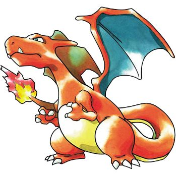

# Pokémon image classifier

This project builds a 1,025-class Pokémon image classifier and exports it as
an ONNX model suitable for CPU inference and [Android integration](https://github.com/Sutadasuto/pokedex_android). It includes:

- a provenance-aware image collector for National Pokédex species 1–1025;
- fine-tuning code for a PyTorch/timm DenseNet121 classifier;
- ONNX conversion and numerical export verification; and
- single-image and reproducible held-out-set evaluation scripts.

The dataset and trained model files are intentionally **not** included in this
repository. They are available at [HuggingFace](https://huggingface.co/Sutadasuto/pokedex_project).

## Repository layout

| Path | Purpose |
| --- | --- |
| `dataset_generator.py` | Collect, validate, normalize, hash, and record image provenance |
| `DATASET_GENERATOR.md` | Detailed provider notes and collection options |
| `train_finetune.py` | Replace the classifier head and fine-tune DenseNet121 |
| `convert_to_onnx.py` | Export a checkpoint and labels to ONNX |
| `test_onnx_image.py` | Print top-k predictions for one image |
| `test_onnx_split.py` | Evaluate a reproducible class-balanced held-out split |
| `pokemon_labels_1025.json` | Class-index metadata for the exported model |

## Data collection

The default collector uses:

- **PokeAPI** for HOME and Official Artwork sprites, including available
  varieties and forms;
- **Pokémon Database** for official-artwork gallery images.

For the dataset used by this project, I collected images from all four
providers: PokeAPI, Pokémon Database, PkmnCards, and Brave Images. I requested
up to 100 images per species from each of the first three providers and up to
20 images per species from Brave Images. The collection command was:

```powershell
python .\dataset_generator.py `
  --output .\pokedex_data `
  --first 1 --last 1025 `
  --sources pokeapi pokemondb pkmncards brave-images `
  --images-per-source 100 100 100 20
```

These are per-source limits; the number of accepted files can be lower when
images are unavailable, invalid, duplicated, or rejected by validation. Every
accepted image is validated with Pillow, normalized to PNG, SHA-256 hashed,
and recorded in `dataset_manifest.csv` with its source URL, page URL,
dimensions, and available license information. Duplicate image bytes are
skipped.

The manifest is provenance information, not a license grant. Pokémon and
third-party imagery may have separate copyrights, trademarks, and site terms.
Review the manifest and the applicable terms before redistributing the dataset
or publishing a model trained on it.


The collector is resumable: existing files are scanned and retained, and
duplicates are skipped. For provider-specific options, including Brave API
credentials, rate-limit behavior, and licensing cautions, see
[`DATASET_GENERATOR.md`](./DATASET_GENERATOR.md).
Never put an API key in the repository; use an environment variable or a
local key file covered by `.gitignore`.

### Published dataset

NOTE: probaly I'll upload the dataset. If so, it is available HERE.

## Model architecture

The classifier uses a **DenseNet121** image backbone from `timm`, initialized
from ImageNet weights or a compatible checkpoint. The original classifier is
removed and replaced with a linear classification head whose output count is
the number of dataset directories (1,025 in the current model). Training uses
224×224 RGB images, ImageNet normalization, randomized crops/affine transforms,
color jitter, and horizontal flips.

The two-stage training schedule first trains the new head, then unfreezes the
final DenseNet feature blocks for low-learning-rate fine-tuning. The ONNX
export has input name `input` with shape `[batch, 3, 224, 224]` and a `logits`
output. The client must perform RGB conversion, resize, NCHW transposition, and
ImageNet normalization before inference.

### Credit and inspiration

The fine-tuning workflow was inspired by and initializes from the published
checkpoint in [BiernyVR/pokemon-classifier-mobilenetv3 on Hugging Face]
(https://huggingface.co/BiernyVR/pokemon-classifier-mobilenetv3). Despite that
repository name, its published checkpoint used here is a PyTorch/timm
DenseNet121 model. Please credit that project when reusing the workflow or
checkpoint. PokeAPI and Pokémon Database are also important upstream data
sources.

## Fine-tuning

Install the training dependencies in a suitable CPU or CUDA environment:

```powershell
python -m pip install torch torchvision timm pillow
```

Download a compatible source checkpoint separately, then run:

```powershell
python .\train_finetune.py `
  --dataset .\pokedex_data `
  --checkpoint .\pokemon_densenet121_best.pth `
  --output .\pokemon_densenet1025_best.pth `
  --labels-output .\pokemon_labels_1025.json
```

The script discovers classes from directory names, requires exactly 1,025
classes, creates a class-balanced 15% validation split using seed `123`, trains
the new head, and then fine-tunes the final DenseNet blocks. Use
`--device cuda` to require CUDA or `--device cpu` to force CPU training.

To improve the model, add reviewed images to existing class directories and
rerun training with a new output checkpoint. When new Pokémon are released,
add a zero-padded class directory and its images, update the expected class
count in `train_finetune.py` if needed, and train a new head from the backbone
checkpoint. Then update the `num_classes` value in `convert_to_onnx.py` and
the class-count guard in `test_onnx_split.py` before exporting and evaluating.
Do not append classes to an existing model without also exporting matching
labels and updating the consumer's class count. For a class count other than
1,025, all of these explicit checks and the downstream client must be adjusted
together.

## Convert to ONNX

Install the export dependencies:

```powershell
python -m pip install onnxruntime
python -m pip install --no-deps onnx==1.12.0
```

Export and verify the trained checkpoint:

```powershell
python .\convert_to_onnx.py `
  --checkpoint .\pokemon_densenet1025_best.pth `
  --output .\pokemon_classifier_1025.onnx `
  --labels .\pokemon_labels_1025.json `
  --verify
```

The `--verify` option compares PyTorch and ONNX Runtime logits on the same
random input and fails if the numerical difference exceeds the script's
tolerance.

## Test inference

For a single image:

```powershell
python .\test_onnx_image.py `
  --model .\pokemon_classifier_1025.onnx `
  --image .\charizard_1.jpg `
  --labels .\pokemon_labels_1025.json `
  --topk 5
```

Example input image:



Output produced by the current model:

```text
Image: .\charizard_1.jpg
Top predictions:
1. #0006 charizard 99.92%
2. #0005 charmeleon 0.05%
3. #0004 charmander 0.01%
4. #0142 aerodactyl 0.01%
5. #0841 flapple 0.01%
```

Percentages are softmax scores, not calibrated probabilities. The example is
specific to `charizard_1.jpg` and the model checkpoint used to generate this
README; results may change when the model is retrained.

For a reproducible held-out evaluation:

```powershell
python .\test_onnx_split.py `
  --dataset .\pokedex_data `
  --model .\pokemon_classifier_1025.onnx `
  --labels .\pokemon_labels_1025.json `
  --output .\onnx_test_split
```

This uses the same seed and 15% class-balanced split convention as training
and writes Top-1/Top-5 metrics, per-image top-five reports, a confusion matrix,
and a heatmap. Treat these metrics as dataset-dependent: source overlap,
artwork style, class balance, and near-duplicate images can materially affect
them.

## Responsible use

This is an educational, fan research project and is not an official Pokémon
product. It may perform poorly on photographs, fan art, uncommon poses,
occluded subjects, multiple Pokémon, or images outside the collection
distribution. Do not use predictions as an authoritative identification
system. Respect the terms of every upstream API and image host, and remove
images from any redistribution package when their rights are unclear.

## License

The original source code in this repository is intended to be released under
the [MIT License](https://choosealicense.com/licenses/mit/).

The MIT License applies only to original project code. It does not grant
rights to Pokémon characters, names, logos, or trademarks, which belong to
their respective rights holders, nor does it grant rights to images collected
from PokeAPI, Pokémon Database, PkmnCards, Brave Images, or other third-party
sources. The dataset and trained model weights may therefore require separate
terms and rights review before redistribution.

This is an unofficial project and is not affiliated with or endorsed by
Nintendo, Game Freak, or The Pokémon Company. The MIT License also does not
provide permission to use those parties' intellectual property or guarantee
that a third party will not object to a particular use.
